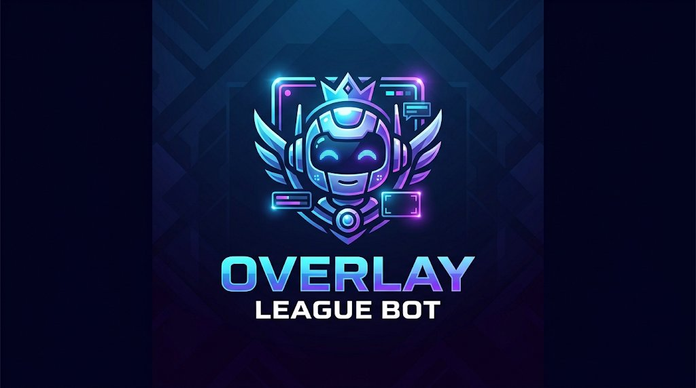

<p align="center">
  
</p>

<h1 align="center">OverlayLeagueBot</h1>

<p align="center">
  <strong>Overlay em tempo real para League of Legends no OBS Studio</strong><br />
  HUD do jogador, runas, histórico de compras, alertas de itens (compra/venda/desfazer), monstros da selva, multikills e sons personalizados.
</p>

---

## ✨ Recursos Principais

- **Leitura local automática (Live Client Data API)**: conecta diretamente ao cliente do League of Legends durante a partida (`https://127.0.0.1:2999`), sem precisar de chave de API da Riot.
- **4 URLs independentes para Browser Source no OBS**:
  - **Overlay Completo (`/overlay.html`)**: HUD com campeão, nível, timer, KDA, torres, CS, ouro, visão, inventário, página de runas, histórico de compras e alertas.
  - **Somente Itens (`/item-toast.html`)**: exibe compra, venda (em cinza + ouro ganho) e item desfeito (*undo*).
  - **Eventos de Monstros (`/monster-events.html`)**: Dragões elementais (Infernal, Oceano, Montanha, Nuvens, Hextec, Quimtec e Ancião), Barão, Arauto e Vastilarvas.
  - **Eventos do Mapa (`/map-events.html`)**: Torres, Inibidores, Abates, Mortes, Assistências, First Blood até Pentakill e Ace.
- **5 Modelos de Layout + Customização do Overlay Completo**:
  - Modelos: `Clássico`, `Compacto (Slim)`, `Barra Broadcast (Esports)`, `Card Lateral (Vertical)` e `Minimalista (Glass)`.
  - Personalização de posição na tela, tema de cores (incluindo seletor customizado), opacidade, bordas, escala e tipografia.
- **Fila de Execução (FIFO)**: múltiplos itens comprados/vendidos ou eventos disparados rapidamente são exibidos em sequência, sem cortar a animação anterior.
- **Reconhecimento de Time Aliado vs. Inimigo**: objetivos e vantagens do time inimigo são destacados em cinza com alerta sonoro negativo.
- **Personalização Total**: envie seus próprios **GIFs/imagens** para cada evento e **arquivos de áudio** (`.mp3`, `.wav`, `.ogg`, `.webm`, `.m4a`) com controle de volume.
- **Modo Mock (Testes)**: simule uma partida completa e dispare qualquer evento pelo painel antes de entrar ao vivo.

---

## 📥 Como Baixar e Usar (Com Launcher Automático)

### 1. Pré-requisito
- Instale o **Node.js (versão LTS)** em [nodejs.org](https://nodejs.org/).

### 2. Baixar o Projeto
- **Opção A — Release Pronta para Executar (Recomendado):**
  1. Acesse [**Releases no GitHub**](https://github.com/Rogerio-Viana/OverlayLeagueBot/releases/latest) e baixe o arquivo **`OverlayLeagueBot-v...-win.zip`**.
  2. Extraia o ZIP em uma pasta (ex: `C:\OverlayLeagueBot`). *(Este pacote já vem compilado e com as dependências incluídas para abrir instantaneamente!)*
- **Opção B — Código-fonte (ZIP):**
  1. No repositório do GitHub, clique no botão verde **`<> Code`** → **`Download ZIP`**.
  2. Extraia o arquivo ZIP em uma pasta de sua preferência (ex: `C:\OverlayLeagueBot`).
- **Opção C — Via Git:**
  ```bash
  git clone https://github.com/Rogerio-Viana/OverlayLeagueBot.git
  cd OverlayLeagueBot
  ```

### 3. Executar com 1 Clique (Launcher)
Na pasta do projeto, dê **duplo clique** no arquivo:

```text
Iniciar-OverlayLeagueBot.bat
```

O launcher faz tudo automaticamente para você:
1. Verifica se o Node.js está instalado.
2. Na primeira execução, instala as dependências (`npm install`) e compila o projeto (`npm run build`).
3. Inicia o servidor local na porta `3333` e **abre o painel (`http://localhost:3333`) automaticamente no seu navegador**.

> ⚠️ **Importante:** mantenha a janela do terminal aberta enquanto estiver usando o overlay na transmissão.

### Alternativa via Terminal
```bash
npm install
npm run build
npm run start:open
```

---

## 🎥 Como Configurar no OBS Studio

1. Abra o **OBS Studio**.
2. Na cena desejada, clique em **`+`** em **Fontes** e escolha **Navegador (Browser)**.
3. Dê um nome à fonte (ex: `LoL - Overlay Completo`).
4. Cole uma das URLs disponíveis no painel:
   - **Overlay Completo:** `http://localhost:3333/overlay.html` *(recomendado: Largura `1920`, Altura `1080`)*
   - **Somente Itens:** `http://localhost:3333/item-toast.html` *(ex: Largura `420`, Altura `180`)*
   - **Eventos de Monstros:** `http://localhost:3333/monster-events.html` *(ex: Largura `480`, Altura `180`)*
   - **Eventos do Mapa:** `http://localhost:3333/map-events.html` *(ex: Largura `480`, Altura `180`)*
5. *(Opcional)* Marque **"Controlar áudio via OBS"** se quiser ajustar o volume dos alertas diretamente no Mixer de Áudio do OBS.
6. Clique em **OK** e posicione a fonte na sua tela.

### Testando sem abrir o League of Legends
1. No painel web (`http://localhost:3333`), vá até a aba **Testes & Prévia ao Vivo**.
2. Clique em **Ativar Modo Mock**.
3. Clique nos botões de **Simular Compra/Venda** ou nos eventos (**First Blood**, **Pentakill**, **Dragão Ancião**, etc.) para ver e ouvir tudo funcionando no OBS em tempo real.

---

## 📸 Adicionando Prints ao Repositório

Caso queira incluir capturas de tela da sua própria transmissão ou do painel no GitHub:
1. Salve suas imagens em `docs/images/` (por exemplo, `docs/images/painel.png` e `docs/images/obs-overlay.png`).
2. Referencie no markdown com ``.

---

## 🛠️ Estrutura do Projeto

```text
├── Iniciar-OverlayLeagueBot.bat   # Launcher Windows (instala, inicia e abre o navegador)
├── package.json                   # Scripts e dependências Node.js
├── src/
│   ├── server.ts                  # Servidor Express + WebSocket + API de config/uploads/mock
│   ├── types/lol.ts               # Tipagens do estado, eventos, HUD e configurações
│   └── services/
│       ├── lolClient.ts           # Integração com a Live Client Data API (porta 2999)
│       ├── ddragon.ts             # Cache de ícones de campeões, itens e runas (Data Dragon)
│       ├── configService.ts       # Persistência em config.json
│       └── mockData.ts            # Simulador de partida e eventos (Modo Mock)
└── public/
    ├── index.html                 # Painel de configuração e prévia ao vivo
    ├── dashboard.css              # Tema visual do painel
    ├── overlay.html / .css / .js  # Browser Source: Overlay Completo
    ├── item-toast.html / .js      # Browser Source: Somente Itens
    ├── monster-events.html        # Browser Source: Eventos de Monstros
    ├── map-events.html            # Browser Source: Eventos do Mapa
    ├── event-toast.js             # Fila e animação das URLs dedicadas de eventos
    ├── event-icons.js             # Ícones oficiais dos monstros, dragões e mapa
    └── sound-player.js            # Reprodução de áudio padrão e personalizada
```

---

<p align="center">
  Made with ❤️ by <a href="https://github.com/Rogerio-Viana">RogersV</a>
</p>
